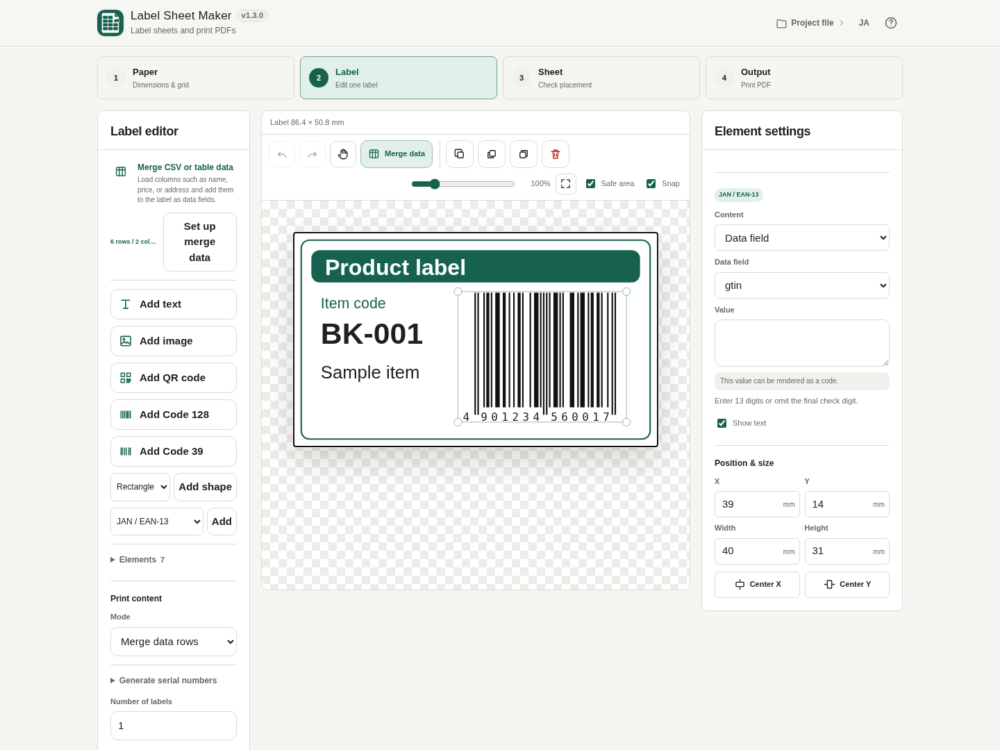

# Label Sheet Maker

[](https://github.com/ttomohisa/htmlapps-label-sheet-maker/actions/workflows/deploy-pages.yml)
[](LICENSE)
[](https://ttomohisa.github.io/htmlapps-label-sheet-maker/)

[日本語版 README](README.ja.md)

A single-HTML app for defining physical label-sheet geometry, designing one label, merging local CSV / TSV data, reusing partially used sheets, and creating print-ready PDFs without uploading your files to a server.

## 🚀 Live demo

### [Open Label Sheet Maker on GitHub Pages](https://ttomohisa.github.io/htmlapps-label-sheet-maker/)

GitHub Pages delivers the initial HTML. After it loads, sheet geometry, label editing, CSV / TSV parsing, local images, QR / barcode generation, project save / restore, and PDF generation are processed locally on your device. Files and values selected in the app are not uploaded by the app.

[](https://ttomohisa.github.io/htmlapps-label-sheet-maker/)

## Features

- **Define sheets by real dimensions** — Use A4, Letter, custom paper, or generic or manufacturer/product-code presets and adjust label size, rows, columns, margins, and gaps in mm or inches.
- **Design one label directly on the canvas** — Add text, local PNG / JPEG / WebP images, QR codes, Code 128, and Code 39; move, resize, duplicate, reorder, delete, undo, and redo without leaving the editor.
- **Merge local data into labels** — Load UTF-8, UTF-8 BOM, or Shift_JIS CSV / TSV files, drag and drop them, or paste spreadsheet-style table data and bind columns to text or code elements.
- **Reuse partially used label sheets** — Mark already-used positions on the first sheet and fill only the remaining labels while preserving data order. Later pages are treated as fresh sheets.
- **Calibrate print position** — Apply X/Y offsets in 0.1 mm steps, save named local calibration presets, and create a calibration PDF with outlines, center marks, and position numbers.
- **Create print-ready PDFs locally** — Generate A4, Letter, or custom-size PDFs with a final page preview and explicit Actual Size / 100% printing guidance.
- **Resume work later** — Save paper settings, label elements, embedded local images, merge data, used positions, and output settings in one `.labelsheet.json` project file.
- **Desktop and touch-friendly editing** — Double-click text to edit on desktop; on mobile use the fixed selected-element action bar or long-press menu. Snapping can be toggled, and holding `Alt` while dragging temporarily disables it.
- **Private single-HTML operation** — Japanese / English UI, no account, no runtime CDN, no analytics or telemetry, no remote font, and `connect-src 'none'` in the Content Security Policy.

While Help, a save dialog, or a confirmation dialog is open, background scrolling is paused. Scroll inside the dialog to read its contents; normal page scrolling resumes after closing it.

### Safer editing and saving

- Finish a valid Paper value before leaving its field. Temporary or invalid input keeps existing label content and used positions intact; field errors explain what to correct. Empty or non-finite dimensions show “—” in preview measurements. A deliberately smaller valid label can resize/clamp existing content.
- Duplicate CSV column names stay separate, including names that already end in a suffix. Newer file/paste choices win if an earlier read finishes later.
- Create a new PDF after changing printable content, count, used positions, or calibration. Old results are cleared, and an unfinished paper edit disables export. Save uses the filename currently shown.
- Empty or invalid element position/size entries return to the last committed value with a field error. Correct the number to continue; width and height must be positive. Selection or unit changes clear stale feedback.
- Undo/Redo and document-context changes retire unfinished drags so late pointer events cannot overwrite restored work.
- Canvas shortcuts act only while the Label canvas has focus. Enter/Space on a first-sheet position keeps keyboard focus on that position.

## Quick start

### Use the web demo

Just [open the demo](https://ttomohisa.github.io/htmlapps-label-sheet-maker/). No installation or account is required.

### Use the downloaded HTML

1. Download `label-sheet-maker.html` from [GitHub Releases](https://github.com/ttomohisa/htmlapps-label-sheet-maker/releases). The readable file is also available at the repository root.
2. Open it in a current Chromium-based browser, Firefox, or Safari.
3. The app can run directly from the local HTML file without a local web server.

The release also includes `label-sheet-maker.self-extract.html` (built as `dist/index.self-extract.html`). It contains the same app as a gzip-compressed self-extracting single HTML file and expands locally in the browser.

### Build it fully offline-ready (advanced)

1. Download or clone this repository.
2. Double-click `build-standalone.bat` on Windows.
3. The builder validates the repository and generates the standalone files under `dist/`.
4. Copy `dist/index.html` or `dist/index.self-extract.html` wherever you need it.
5. Open that single file later without an internet connection.

Python, Node.js, and a local web server are not required for the standard Windows build. The builder uses Windows PowerShell.

## Usage

1. In **Paper**, choose a generic preset or set A4 / Letter / Custom dimensions. Enter label width and height, rows and columns, margins, and gaps.
2. Check the live sheet preview and the calculated right / bottom margins.
3. In **Label**, add text, images, QR codes, Code 128, or Code 39. Drag an element frame to move it and use the corner handles to resize it.
4. For variable labels, open **Merge data**, load a CSV / TSV file or paste a table, then add loaded columns as data fields.
5. Switch preview rows to confirm how merged text and code values change.
6. In **Sheet**, tap positions that have already been used on the first physical sheet. Labels are assigned only to remaining positions in order.
7. Review additional pages. Page 2 and later are composed as fresh sheets.
8. In **Output**, create a calibration PDF when needed, adjust X/Y print offsets, and optionally save the calibration as a local preset.
9. Create the print-ready PDF and print it at **Actual size / 100%**.
10. Expand **Project file** in the header to save or open `.labelsheet.json`. You can also drop a project file onto that control.

Built-in presets include generic dimensions and independent layouts based on published manufacturer dimensions. They are not official manufacturer templates.

### Batch labels

- Expand **Generate serial numbers** in Label and enter start, increment, count, minimum digits, prefix and suffix. Generate up to 10,000 non-negative serial numbers as a `serial` data column; existing merge data is replaced only after confirmation. Add the column as text or bind it to a QR/barcode field.
- Expand **Copies per row** in merge mode. Set the current row's copies, or apply an integer quantity column to all rows. Zero excludes a row; the initial quantity is one. Invalid values leave previous quantities unchanged. Explicit quantities allow up to 10,000 copies per row and a total of 10,000 (or the original row count if larger). New data imports reset quantities.
- In Text style, enable **Shrink text to fit** and choose a minimum font size (4 pt or more). The same per-row layout is used in the editor, sheet and print PDF. Text that still does not fit at the minimum is flagged by the print check; review the final preview.
- Choose from 20 generic A4/Letter layouts and 13 named A-one/HISAGO A4 layouts; check actual stock dimensions and margins before printing.
- Projects using custom quantities, auto-fit, shapes, non-default text colors or new barcode formats use schema 2 so older versions cannot silently ignore the settings. v1.3.0 reads both schemas; projects without these features remain schema 1.

### Shapes, colors and additional barcodes

- Add rectangles, rounded rectangles, ellipses or lines. Set fill, outline color, stroke width, corner radius or line direction. Text color is editable separately. Shapes use the same position/size, stacking, duplicate, Undo and project save controls as other elements.
- JAN/EAN-13 (12 or 13 digits), JAN/EAN-8 (7 or 8 digits) and UPC-A (11 or 12 digits) calculate a missing check digit and reject a wrong supplied check digit. ITF accepts 2–80 digits in pairs, without automatic check digits or ITF-14 bearer bars. Fixed values and merged columns both work. Preserve leading zeros in CSV. Code generation does not assign or register GTINs. EAN/UPC use format-specific guard bars and digit placement. Dimension warnings are estimates for general retail POS, not print-quality or conformance certification; verify the printed symbol with the intended scanner and applicable GS1 requirements before production use.


### Editing features

- Expand **Elements** to select overlapping objects. Use Fit to view to reset the canvas zoom.
- Select an image and choose **Replace image** to keep its position, frame size, fit and stacking order.
- Delimiter and encoding options are under **Import settings**. Malformed quotes or inconsistent column counts reject the import without replacing previous data.
- In Sheet, use **Drag to select** to mark or clear multiple positions according to the first slot touched. Undo is available immediately afterward. A fully used first sheet is omitted from the print PDF.
- **Check before printing** reports empty or overflowing text, missing merge columns, code errors, estimated image resolution and label frames extending beyond the paper. Results are estimates, not a guarantee of print or scan quality.
- The initial introduction disappears after choosing a workflow step.

### Label editor controls

- Click or tap an element to select it.
- Drag the element frame to move it.
- In **Element settings → Position & size**, use **Center horizontally** or **Center vertically** to center the selected frame on the label. Size, text alignment, and the other axis stay unchanged; Undo restores the previous position.
- Drag a corner handle to resize it. Touch devices use a larger invisible hit target around each handle.
- Double-click a fixed-text element on desktop to jump to the text field and select its full value.
- Use the contextual canvas actions to edit, duplicate, move forward / backward, or delete the selection.
- On mobile, selecting an element reveals a fixed action bar above the four workflow tabs.
- Long-press an element on touch devices to open the context menu. Moving your finger cancels the long-press and continues as a normal drag.
- Turn snapping on or off from the canvas toolbar. Hold `Alt` while dragging to bypass snapping temporarily.

### Keyboard shortcuts

| Shortcut | Action |
| --- | --- |
| `Ctrl` / `⌘` + `Z` | Undo |
| `Ctrl` / `⌘` + `Shift` + `Z` | Redo |
| `Delete` / `Backspace` | Delete the selected element |
| `Esc` | Clear the current selection |
| `←` / `→` / `↑` / `↓` | Move the selected element by 0.2 mm |
| `Shift` + Arrow key | Move the selected element by 1 mm |
| `Alt` + drag | Temporarily move without snapping |

Deleting an element also shows an **Undo** action in the toast message.

## Publish with GitHub Pages

The repository includes a workflow that builds the standalone HTML, verifies it, and deploys `dist/` to GitHub Pages.

1. Push the repository to GitHub as `htmlapps-label-sheet-maker`.
2. Open **Settings → Pages → Build and deployment → Source** and select **GitHub Actions**.
3. Push to `main`, or manually run **Deploy standalone app to GitHub Pages** from the Actions tab.
4. After a successful deployment, the demo is available at `https://ttomohisa.github.io/htmlapps-label-sheet-maker/`.

Each push to `main` runs the repository checks before Pages deployment. Pull requests that touch the build inputs run **Validate standalone HTML**. After successful main validation and Pages deployment, the workflow publishes the tag and GitHub Release for the version in `app.config.json`, without overwriting an existing tag or release.

## Development and build layout

```text
.
├─ src/index.template.html       # Application template
├─ app.config.json               # Product metadata and build settings
├─ dependencies.json             # Runtime dependency declarations (currently empty)
├─ build-standalone.bat          # Windows build entry point
├─ build-standalone.ps1          # Standalone HTML builder
├─ scripts/                      # Validation and self-extract helpers
├─ tests/                        # Core, static, UX, and release regression tests
├─ dist/
│  ├─ index.html                 # Readable single-HTML build
│  └─ index.self-extract.html    # Gzip self-extracting single-HTML build
└─ .github/workflows/
   ├─ build-standalone.yml       # Pull request build validation
   └─ deploy-pages.yml           # Automatic Pages deployment from main
```

Edit `src/index.template.html`, not generated HTML. The build also synchronizes `label-sheet-maker.html` with `dist/index.html`; the root download and readable build contain identical bytes.

### Build on Windows

```bat
build-standalone.bat
```

The build process validates PowerShell syntax, repository structure, standalone output, and the self-extracting build. It also generates build and dependency manifests under `dist/`.

### Run tests

The repository contains regression tests for the paper-layout core, label editor, data merge, images / codes, sheet composition, PDF output, project files, mobile UX, long-press behavior, and release checks.

After building, run all tests with Node.js 22 or newer. The full repository check also runs this command:

```bash
node scripts/run-app-tests.mjs
```

On Windows PowerShell:

```powershell
node scripts/run-app-tests.mjs
```

## Privacy and runtime network protection

The generated app is designed for **fully local processing** of the user's label data.

- A Content Security Policy includes `connect-src 'none'`.
- There is no runtime CDN, API call, analytics, telemetry, or remote font.
- CSV / TSV files, pasted tables, local images, QR / barcode values, project files, and PDF generation stay in the browser.
- Custom sheet layouts and print-calibration presets are stored in browser site storage.
- Autosave is off by default. Enabling it in Project file stores a recovery snapshot, including images and table data, in this browser's local storage. Restore or discard it on reopening. Turning autosave off removes the recovery snapshot. Storage quotas, private browsing or clearing site data may prevent recovery; save important work as a portable project.
- `.labelsheet.json` project files are created locally and can contain the embedded images and merge data needed to resume the job.

The GitHub Pages version requires the initial HTML request, but data selected or entered after the app loads is not uploaded by the app. For use with the network completely disconnected, open the generated `dist/index.html` locally.

## Limitations

- Named layouts reference published dimensions; they are not official templates supplied by label-sheet manufacturers. Check the actual sheet dimensions before printing.
- Print-ready pages are rendered at approximately 300 dpi for output fidelity; PDF text is not intended to remain searchable or editable.
- Code 128 currently uses Set B and accepts printable ASCII characters. Code 39 accepts uppercase letters, digits, spaces, and its supported symbol set.
- QR codes are generated from UTF-8 text, but very small printed QR codes can become difficult to scan.
- Image input is limited to local PNG, JPEG, and WebP files. SVG image import and remote image URLs are not supported.
- CSV / TSV and pasted table data are supported; XLSX and Google Sheets are not supported.
- Used-label positions are selected manually. Camera-based automatic detection is not included.
- The app generates PDF files but does not control printer drivers or printer hardware. Final alignment can still depend on printer feed accuracy and print-dialog scaling.
- Very large custom paper sizes, many high-resolution images, or large merge datasets can require substantial browser memory. PDF generation limits accumulated JPEG data to 128 MiB; split large jobs.
- Project files can include embedded image and merge data, so they may contain sensitive information. Store and share them accordingly.

## Third-party code

| Component | License | Purpose |
| --- | --- | --- |
| Project Nayuki QR Code generator algorithms (adapted) | MIT | QR encoding and error-correction structure |

Code 39, Code 128, EAN-13, EAN-8, UPC-A and ITF are implemented locally from their published symbol structures; no external barcode runtime package is bundled. `dependencies.json` currently contains no runtime package dependency.

See [THIRD_PARTY_NOTICES.md](THIRD_PARTY_NOTICES.md) for the full notice.

QR Code is a registered trademark of DENSO WAVE INCORPORATED.

## Contributing

Bug reports and feature proposals are welcome through GitHub Issues. See [CONTRIBUTING.md](CONTRIBUTING.md) for development guidance.

## License

Copyright © 2026 ttomohisa

Licensed under the [MIT License](LICENSE).
